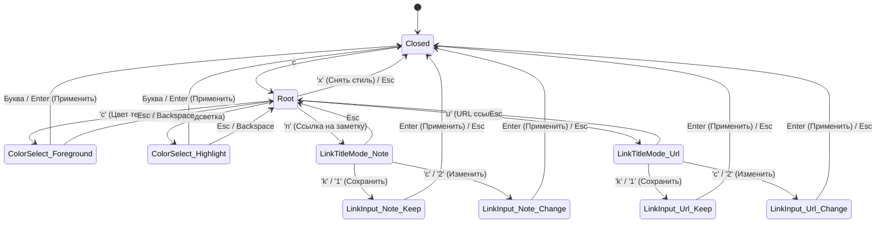

# Дизайн: Интегрированное контекстное Which-Key меню форматирования текста (`<Space> c`)

**Дата:** 2026-11-07  
**Статус:** Утверждён  

## 1. Контекст и цели

Ранее нажатие комбинации `<Space> c` открывало глобальный центральный модальный диалог навигатора (`NavigatorMode::Colors`), отрывая фокус пользователя от редактируемого текста.

**Цель:** Заменить вызов глобального навигатора по `<Space> c` на компактное всплывающее контекстное меню (`TextActionMenu`), привязанное непосредственно к координатам курсора / выделенного фрагмента текста в редакторе.

Меню предоставляет быстрый доступ к:
1. Выделению текста цветом (Foreground ``).
2. Подсветке текста маркером (Background `<mark style="background-color:...">`).
3. Вставке ссылки на заметку (`[[...]]`) с выбором режима названия (сохранить выделенный текст или изменить).
4. Вставке URL ссылки (`[...] (...)`) с выбором режима названия.
5. Выбору цвета через двухуровневое Which-Key меню (как мгновенным нажатием горячих букв, так и навигацией стрелками `←`/`→`/`↑`/`↓` + `Enter`).
6. Автоматическому захвату слова под курсором в Normal-режиме, если нет активного визуального выделения.

---

## 2. Архитектура компонентов

### 2.1. Модуль состояния `TextActionMenu` (`crates/ui/src/overlays/text_action.rs`)
Управляет жизненным циклом и состояниями всплывающего меню:
- `target: SelectionTarget` — диапазон текста, к которому будет применено действие.
- `mode: TextActionMenuMode` — активное состояние меню.
- `cursor_pos: Option<egui::Pos2>` — экранные координаты курсора для привязки окна.
- `color_selection_index: usize` — индекс активного цвета при навигации стрелками.
- `is_open: bool` — флаг видимости.

### 2.2. Переходы состояний (`TextActionMenuMode`)

### 2.3. Палитра цветов
Поддерживает 7 стандартных цветов палитры Nord:
- `[r]` Красный (`#BF616A`)
- `[o]` Оранжевый (`#D08770`)
- `[y]` Жёлтый (`#EBCB8B`)
- `[g]` Зелёный (`#A3BE8C`)
- `[b]` Голубой (`#88C0D0`)
- `[s]` Синий (`#81A1C1`)
- `[p]` Фиолетовый (`#B48EAD`)

---

## 3. Интеграция с редактором и Markdown

1. **Захват цели (`SelectionTarget`)**:
   - В `VisualChar` / `VisualLine`: захватывается активное выделение через `application.capture_selection()`.
   - В `Normal`: вычисляются границы текущего слова под курсором `[word_start..word_end]`. Если курсор на пробеле/пустой строке, выводится подсказка в статусную строку.
2. **Форматирование**:
   - Цвет текста: `truff_core::markdown::style::apply_text_color(...)`.
   - Маркер: `truff_core::markdown::style::apply_highlight(...)`.
   - Очистка: `truff_core::markdown::style::remove_style(...)`.
   - Вики-ссылка: `truff_core::markdown::LinkSelection::wikilink(...)`.
   - Markdown-ссылка: `truff_core::markdown::LinkSelection::markdown_link(...)`.
3. **Undo/Redo**: Все операции генерируют транзакции с единой группой отката `UndoGroup::next()`, откатываемые за 1 шаг по `u`.

---

## 4. План тестирования

1. Модульные тесты `crates/ui/src/overlays/text_action.rs`:
   - Навигация стрелками и мгновенный выбор буквой.
   - Захват слова в Normal mode.
   - Переходы между режимами ссылок.
2. Интеграционные тесты `crates/ui/tests/text_action_menu.rs`:
   - Вызов по `<Space> c` в Visual и Normal режимах.
   - Применение цветов текста и подсветки.
   - Создание ссылок на заметки и URL в обоих режимах названий (сохранить/изменить).
   - Проверка отката через `u`.
