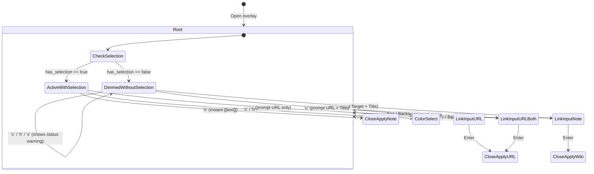

# Design: Smart Text Action Link Workflow in Truff

**Date:** 2026-11-07  
**Status:** Approved  
**Trigger:** Redo link creation in `<Space> c` text action menu to automatically use selected text as the link name/target, or prompt for both target and title when no text is selected.

---

## 1. Overview and Motivation

Previously, selecting a link option in the `<Space> c` inline which-key overlay required navigating a two-step `[k] Keep title / [c] Change title` prompt and then typing a target in an input box. Furthermore, if no word or visual selection was present under the cursor, `<Space> c` could not open at all.

This design introduces a streamlined, low-friction link workflow:
1. **With selection or word under cursor:**
   - Pressing `n` (Note link) instantly wraps the selection into `[[selected_text]]` and closes the overlay in **1 keystroke**.
   - Pressing `u` (URL link) immediately prompts for `URL: [   ]` with the title locked to the selected text, and pressing `Enter` inserts `[selected_text](url)`.
2. **Without selection (whitespace or empty line):**
   - The `<Space> c` overlay opens anchored at the cursor position.
   - Style actions (`c` Color, `h` Highlight, `x` Remove) are visually dimmed and inactive.
   - Pressing `n` prompts for two fields: `Target (note):` and `Title (optional):` (toggled via `Tab`). Submitting with `Enter` inserts `[[target]]` (if title is empty) or `[[target|title]]` (if title is provided).
   - Pressing `u` prompts for `URL:` and `Title:` (toggled via `Tab`), inserting `[title](url)` on `Enter`.

---

## 2. Architecture and Data Flow

### 2.1 State Machine (`TextActionOverlay` & `TextActionMode`)



### 2.2 Mode Representation

```rust
pub enum TextActionMode {
    Root {
        has_selection: bool,
    },
    ColorSelect {
        is_highlight: bool,
    },
    LinkInput {
        is_url: bool,
        has_selection: bool,
        target_input: String,
        title_input: String,
        active_field: usize, // 0: target/url, 1: title
    },
}
```

The intermediate `LinkTitleMode` enum variant is removed.

### 2.3 Selection and Cursor Target Capture

In `crates/ui/src/app/selection.rs`:
- Add `capture_selection_or_cursor(&self) -> AppResult<(SelectionTarget, bool)>`:
  1. Check visual selection (`capture_selection()`). If present, return `(target, true)`.
  2. Check word under cursor (`word_boundary_at`). If present, return `(target, true)`.
  3. Otherwise, capture zero-length cursor target `cursor..cursor` and return `(target, false)`.
- Update `apply_note_link_target`:
  - If range is empty (`range.is_empty()`):
    - If `custom_title` is provided: insert `[[note|custom_title]]`.
    - If `custom_title` is None: insert `[[note]]`.
  - If range is non-empty:
    - If `custom_title` is None: wrap selection as `[[note]]`.
    - If `custom_title` is Some: wrap selection as `[[note|custom_title]]`.
- Update `apply_url_link_target`:
  - If range is empty:
    - Insert `[label](url)` where label is `custom_title` or `url`.
  - If range is non-empty:
    - Insert `[label](url)` where label is `custom_title` or buffer text.

---

## 3. UI Rendering and Aesthetics

In `crates/ui/src/native/text_action.rs`:
- **Root Menu**:
  - If `has_selection == true`: Render all pills (`c`, `h`, `n`, `u`, `x`) normally with bright keys and descriptions.
  - If `has_selection == false`: Render `n` and `u` as bright pills; render `c`, `h`, `x` with dimmed styling (`theme.text_secondary.gamma_multiply(0.4)`).
- **LinkInput**:
  - When `has_selection == true` and `is_url == true`:
    - Display label: `Text: "<selected_text>"`
    - Single text input: `URL: [   ]`
    - Keyboard hints: `[Enter] Apply · [Esc] Cancel`
  - When `has_selection == false`:
    - If `is_url == false`:
      - Input 0: `Note:  [   ]`
      - Input 1: `Title: [   ] (optional)`
    - If `is_url == true`:
      - Input 0: `URL:   [   ]`
      - Input 1: `Title: [   ]`
    - Keyboard hints: `[Tab] Switch field · [Enter] Apply · [Esc] Cancel`

---

## 4. Verification Strategy

1. **Unit Tests (`crates/ui/src/overlays/text_action.rs`)**:
   - `test_root_menu_with_selection_n_immediately_applies`: 'n' returns `ApplyLink { is_url: false, target, title: None }`.
   - `test_root_menu_with_selection_u_opens_single_url_input`: 'u' transitions to `LinkInput` with `has_selection = true`.
   - `test_root_menu_without_selection_dims_style_actions`: 'c'/'h'/'x' do not transition; 'n'/'u' enter `LinkInput` with `has_selection = false`.
   - `test_link_input_tab_navigation`: Tab toggles active field when `has_selection == false`.
   - `test_link_input_enter_empty_and_custom_title`: verifies wiki link output with and without title.

2. **Integration Tests (`crates/ui/tests/text_action_menu.rs`)**:
   - Visual selection + `n` -> instant `[[selected]]`.
   - Normal mode word cursor + `n` -> instant `[[word]]`.
   - Empty cursor + `n` -> prompts two fields -> `[[target|title]]` and `[[target]]`.
   - Empty cursor + `u` -> prompts two fields -> `[title](url)`.
   - Selection + `u` -> prompts URL -> `[selected](url)`.
   - Empty cursor + `c` -> warns in status bar, no panic or corrupted state.
